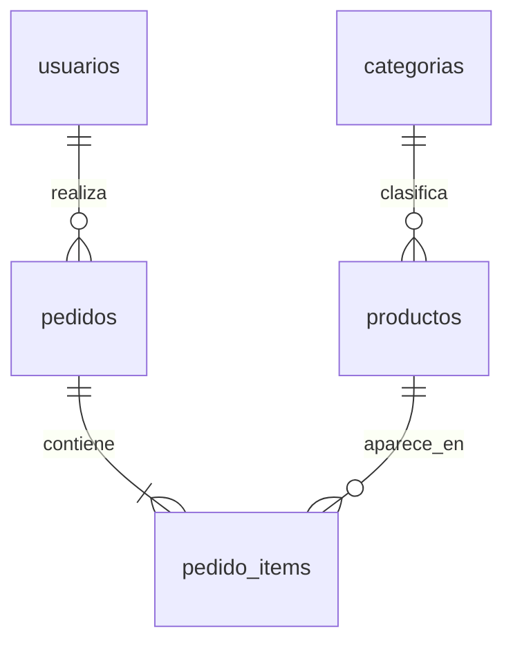

# AQUA-T · Backend Spring Boot (`backend-springboot/`)

API REST de la tienda AQUA-T para la Evaluación 3. Usa la **misma base de datos MySQL local** del proyecto
(`aquat`, esquema en `../backend/db/schema.sql`) e incluye lógica de negocio, Swagger y seguridad con
Spring Security + JWT. El backend en Node (`../backend`) queda como referencia de la evaluación anterior.

## Tecnologías

| Área | Herramienta |
|---|---|
| Lenguaje / framework | Java 17+, Spring Boot 3.5 |
| Base de datos | MySQL (Spring Data JPA / Hibernate) |
| Seguridad | Spring Security, JWT (jjwt), BCrypt |
| Documentación | Swagger UI (springdoc-openapi) |
| Pruebas | JUnit 5, Mockito |

## Requisitos

- JDK 17 o superior y Maven 3.9+
- MySQL local con la base `aquat` creada con `../backend/db/schema.sql`

## Configuración

1. Si la base aún no existe, ejecuta `../backend/db/schema.sql` en MySQL. Hibernate **no** crea ni modifica tablas
   (`ddl-auto=none`): usa las existentes.
2. En `src/main/resources/`, copia `application-local.properties.example` como `application-local.properties`
   y escribe la contraseña de tu usuario de MySQL. Ese archivo NO se sube a GitHub (está en `.gitignore`).
3. Si las tablas están vacías, al iniciar se cargan categorías, productos de ejemplo y 3 usuarios.
   Si ya cargaste datos con `npm run seed`, se respetan y no se duplica nada.

Opcionalmente puedes definir variables de entorno en vez del archivo:

| Variable | Descripción | Valor por defecto |
|---|---|---|
| `DB_HOST`, `DB_PORT`, `DB_NAME` | Conexión a MySQL | `localhost`, `3306`, `aquat` |
| `DB_USER`, `DB_PASS` | Credenciales de MySQL | `aquatadmin`, (vacío) |
| `JWT_SECRET` | Clave de firma JWT (mín. 32 caracteres) | clave de desarrollo |
| `FRONTEND_URL` | Origen(es) permitidos por CORS, separados por coma | `http://localhost:5173` |
| `SERVER_PORT` | Puerto de la API | `8080` |
| `SEED_PASSWORD` | Contraseña de los usuarios de ejemplo (solo si se crean) | `Aquat2026!` |

## Ejecutar

```bash
mvn spring-boot:run
```

- Swagger UI: http://localhost:8080/swagger-ui/index.html
- JSON OpenAPI: http://localhost:8080/v3/api-docs

## Probar la API en Swagger

1. `POST /api/v1/auth/login` con el correo y contraseña de un usuario.
2. Copia el `token` de la respuesta.
3. Pulsa **Authorize** (arriba a la derecha) y pega el token.
4. Prueba los endpoints protegidos.

Usuarios de ejemplo (rol): `ivan.rivera@duoc.cl` (Administrador), `jose.cornejo@gmail.com` (Vendedor),
`jose.cisternas@gmail.com` (Cliente). Si cargaste los datos con `npm run seed`, su contraseña es la del seed.

## Modelo de datos

Las tablas son las del `schema.sql`. Equivalencia con el modelo propuesto en la pauta:

| Modelo de la pauta | Tabla MySQL | Entidad Java |
|---|---|---|
| USUARIO | `usuarios` | `Usuario` |
| BOLETA | `pedidos` | `Boleta` |
| DETALLE_BOLETA | `pedido_items` | `DetalleBoleta` |
| PRODUCTO | `productos` | `Producto` |
| CATEGORIA | `categorias` | `Categoria` |



## Roles y permisos

| Rol | Puede |
|---|---|
| **Administrador** | Todo: productos, usuarios y boletas |
| **Vendedor** | Ver lista y detalle de productos y de boletas (nada más) |
| **Cliente** | Usar la tienda: ver catálogo, comprar (`POST /boletas`) y ver sus compras (`/boletas/mias`) |

## Endpoints (versión 1)

| Método | Ruta | Acceso |
|---|---|---|
| POST | `/api/v1/auth/login` | Público |
| POST | `/api/v1/auth/registro` | Público (crea un Cliente) |
| GET | `/api/v1/productos`, `/api/v1/productos/{id}` | Público |
| POST / PUT / DELETE | `/api/v1/productos`, `/api/v1/productos/{id}` | Administrador |
| GET | `/api/v1/categorias` | Público |
| GET / POST / PUT / DELETE | `/api/v1/usuarios`, `/api/v1/usuarios/{id}` | Administrador |
| POST | `/api/v1/boletas` | Usuario con sesión |
| GET | `/api/v1/boletas/mias` | Usuario con sesión |
| GET | `/api/v1/boletas`, `/api/v1/boletas/{id}` | Administrador y Vendedor |
| PATCH | `/api/v1/boletas/{id}/estado` | Administrador |

Los errores se devuelven como `{ "error": "mensaje" }` con el código HTTP correspondiente
(400 validación, 401 sin sesión, 403 sin permiso, 404 no existe, 409 conflicto).

## Lógica de negocio (`BoletaService`)

Al crear una boleta el backend **no confía en el cliente**: toma los precios desde la base de datos,
valida que haya stock suficiente (409 si no), descuenta el inventario y guarda boleta y detalle en una
sola transacción.

## Pruebas

```bash
mvn test
```

## Integración con el frontend (`../frontend-react`)

1. Definir `VITE_API_URL=http://localhost:8080` y usar rutas `/api/v1/...` en los servicios.
2. Al iniciar sesión, guardar `token` y enviarlo en cada petición protegida: `Authorization: Bearer <token>`.
3. El login devuelve `{ token, usuario }`; `usuario.tipoUsuario` es `Administrador`, `Vendedor` o `Cliente`.
4. Para comprar, enviar solo `productoId` y `cantidad` por ítem; el precio lo calcula el backend.
5. Ocultar en la interfaz las opciones que el rol no puede usar (el backend igual las bloquea).

## Equipo

| Integrante | Responsabilidades |
|---|---|
| (completar) | (completar) |

Convención de commits: mensajes claros y en presente, por ejemplo `Agrega validación de stock en boletas`.
